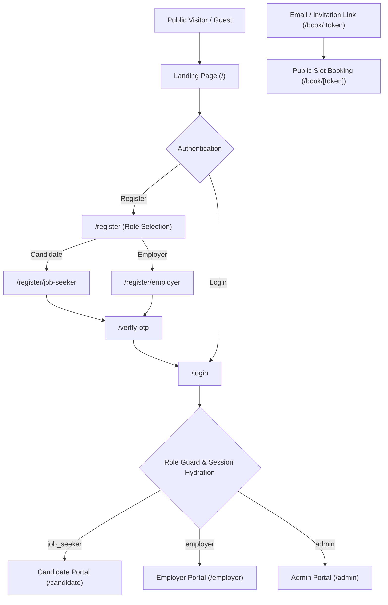
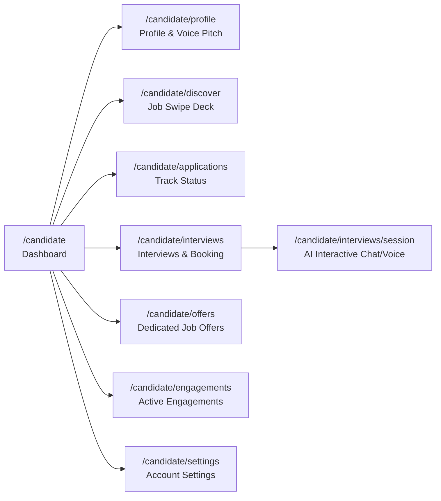
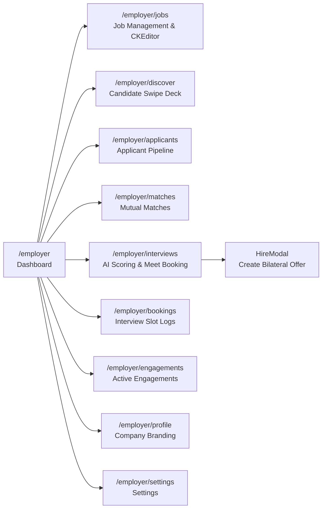
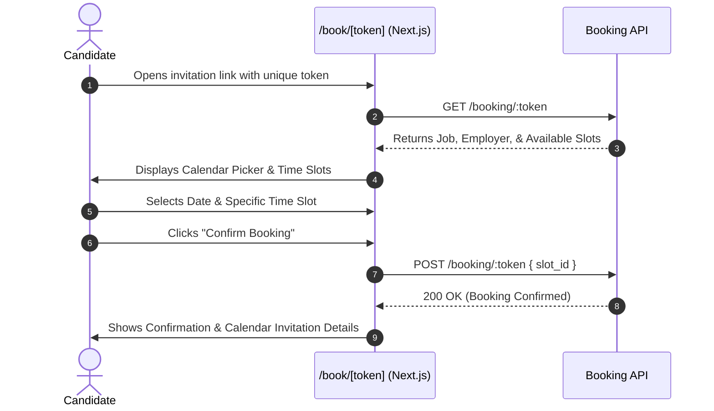
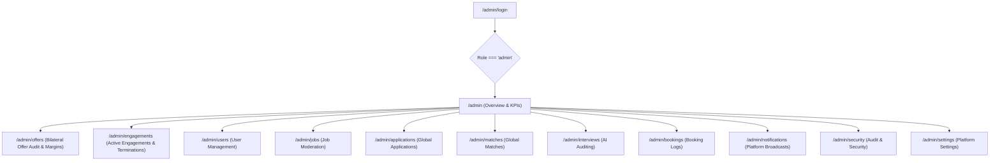
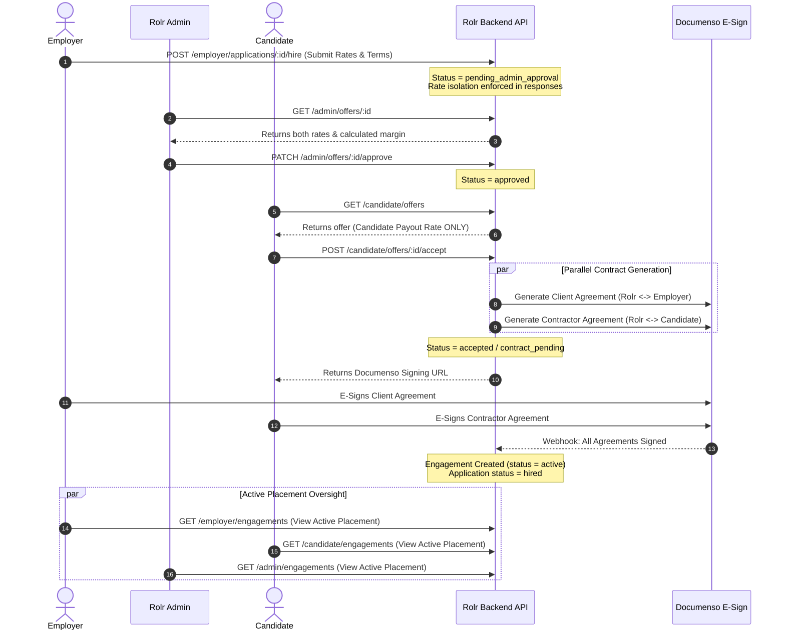
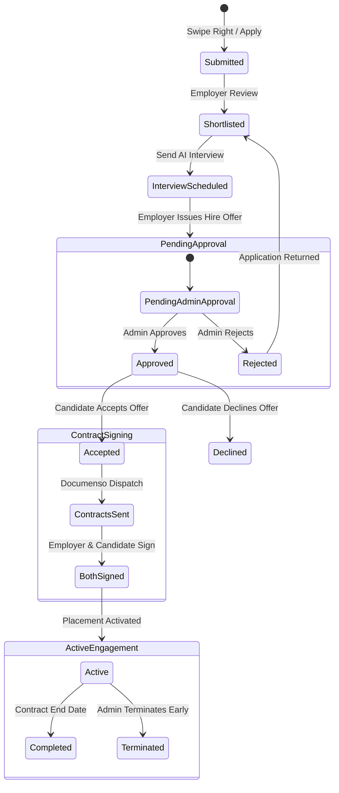

# WorkSwipe (ROLr) - Complete User Flows Specification

This document provides a comprehensive, end-to-end specification of all user flows, role lifecycles, and page routing across the **WorkSwipe (ROLr)** web platform.

---

## 1. System Overview & Architecture

WorkSwipe (ROLr) is an AI-powered, swipe-based job matching, automated interviewing, and bilateral contractor placement platform. The system operates on strict role-based access control (RBAC) across four primary user personas:

1. **Job Seeker (Candidate)**: Swipes on job opportunities, builds a verified profile with an in-browser voice pitch, participates in AI conversational interviews, receives bilateral job offers, e-signs contractor agreements, and manages ongoing engagements.
2. **Employer (Company / Recruiter)**: Creates jobs with auto-populating role templates, discovers candidates via swipe or applicant pipelines, inspects AI interview audio answers and transcripts, schedules Google Meet interviews, issues bilateral hire offers, and tracks active placements.
3. **Public Invitee (Token Booking)**: Accesses tokenized booking links (`/book/[token]`) to choose and confirm interview slots directly without creating an account.
4. **Platform Administrator (Rolr Admin)**: Audits platform metrics, moderates listings, manages user verifications, inspects AI interview accuracy, governs bilateral offer margins, approves/rejects offers, and oversees active engagements and terminations.

---

## 2. Authentication & Onboarding Flow

### 2.1 Public Landing Page (`/`)
- **Route**: `app/page.tsx`
- **Features & User Actions**:
  - Highlights core value propositions: Swipe-based matching, AI-conducted interviews, and guaranteed bilateral contracts.
  - Interactive swipe preview showcase, testimonials, platform statistics, and FAQs.
  - **Get Started / Sign Up**: Routes to `/register`.
  - **Sign In**: Routes to `/login`.

### 2.2 Registration & Role Selection (`/register`)
- **Route**: `app/register/page.tsx`
- **Step 1 - Role Decision**:
  - **Job Seeker Card**: "I'm looking for a job" -> Navigates to `/register/job-seeker`.
  - **Employer Card**: "I'm hiring talent" -> Navigates to `/register/employer`.
- **Step 2A - Job Seeker Registration (`/register/job-seeker`)**:
  - Fields: Full Name, Email, Password, Confirm Password, Terms Agreement.
  - Submits -> Calls API `registerJobSeeker` -> Redirects to `/verify-otp?email={email}`.
- **Step 2B - Employer Registration (`/register/employer`)**:
  - Fields: Company Name, Contact Name, Work Email, Password, Company Size, Industry.
  - Submits -> Calls API `registerEmployer` -> Redirects to `/verify-otp?email={email}`.

### 2.3 Email OTP Verification (`/verify-otp`)
- **Route**: `app/verify-otp/page.tsx`
- **Mechanics**:
  - Reads target email from query string parameter.
  - 6-digit numeric input with auto-advance and backspace handling.
  - **Resend Code**: Interactive countdown timer before allowing re-dispatch.
  - Verification calls API `verifyOtp` -> Stores JWT Bearer token in secure cookies & `useAuthStore` -> Redirects to appropriate portal root (`/candidate` or `/employer`).

### 2.4 Login (`/login`)
- **Route**: `app/login/page.tsx`
- **Mechanics**:
  - Email & password credentials form with real-time field validation.
  - "Remember Me" session toggle.
  - "Forgot Password?" navigation -> `/forgot-password`.
  - Evaluates authenticated JWT role:
    - `job_seeker` -> `/candidate`
    - `employer` -> `/employer`
    - `admin` -> `/admin`

### 2.5 Password Recovery Flow (`/forgot-password` & `/reset-password`)
- **Forgot Password (`/forgot-password`)**:
  - Input: Account email. Calls API `forgotPassword` -> Sends OTP/reset token -> Redirects to `/reset-password?email={email}`.
- **Reset Password (`/reset-password`)**:
  - Inputs: OTP Verification Code, New Password, Password Confirmation.
  - Real-time strength meter. Calls API `resetPassword` -> Success toast -> Redirects to `/login`.

---

## 3. Candidate (Job Seeker) Flow

### 3.1 Candidate Dashboard (`/candidate`)
- **Route**: `app/candidate/page.tsx`
- **Features**:
  - Header with personalized greeting, dark/light theme toggle, and notification bell.
  - Quick Stats Grid: Total Swipes, Active Matches, Submitted Applications, Upcoming Interviews.
  - **Profile Completion Checklist**:
    - Progress bar (0% - 100%).
    - Actionable cards (Basic Info, Voice Pitch, Education, Work Experience, Job Preferences, Portfolio Links).
    - Deep-links directly to `/candidate/profile?edit={section_id}`.

### 3.2 Profile Setup Wizard & Voice Pitch (`/candidate/profile`)
- **Route**: `app/candidate/profile/page.tsx`
- **Sections**:
  1. **Basic Info**: Name, Headline, Bio, Location, Phone, Profile Image Upload (with `ImageCropModal`).
  2. **Voice Introduction (Voice Pitch)**: In-browser voice recorder capturing audio waveform, preview audio playback, and instant upload for AI audio presentation to employers.
  3. **Education**: Degree, Institution, Field of Study, Graduation Year.
  4. **Professional Experience**: Job titles, company history, responsibilities, years of experience.
  5. **Job Preferences**: Desired roles, job type (Full-time, Remote, Contract), minimum expected salary.
  6. **Portfolio & Links**: GitHub, LinkedIn, Personal Website, Portfolio URLs.

### 3.3 Job Discovery & Swiping (`/candidate/discover`)
- **Route**: `app/candidate/discover/page.tsx`
- **Core Components**: `JobSwipeBoard.tsx`, `JobDetailsModal.tsx`.
- **Filter Pills**: `For You`, `Top Jobs`, `Newest`.
- **Swipe Board Mechanics**:
  - Multi-layer 3D card deck showing next job underneath.
  - **Swipe Right / Heart**: Submits positive swipe (`action: "right"`) -> Creates application (`submitted` status) -> Plays fly-off animation.
  - **Swipe Left / Pass**: Discards job (`action: "left"`).
  - **View Details**: Opens modal drawer showing full responsibilities, competencies, salary range, and company profile.

### 3.4 Applications Tracking (`/candidate/applications`)
- **Route**: `app/candidate/applications/page.tsx`
- **Filter Pills**: `Today`, `Weekly`, `Monthly`.
- **Application Card**:
  - Shows Job Title, Company Name, Application Date, and Status Badge.
  - **"Track Status" Action**: Opens `ApplicationTimeline.tsx` modal detailing step-by-step progress with blue dashed connectors and status checkpoints.

### 3.5 AI Interview Workspace (`/candidate/interviews` & `/candidate/interviews/session`)
- **Interviews List (`/candidate/interviews`)**:
  - Shows upcoming AI interview sessions and scheduled video interviews.
  - Expiration countdown timer, job title, required skills, and "Join Interview" button.
- **Interactive Interview Session (`/candidate/interviews/session?session={sessionId}`)**:
  - **Onboarding Overlay**: Greets candidate by name with AI Assistant avatar.
  - **Conversational Question Flow**:
    - AI Bot displays questions one at a time (Behavioral, Situational, Technical).
  - **Dual Answer Submission**:
    - **Voice Answer**: Candidate presses microphone -> Records live response -> Real-time animated waveform -> Stop -> Listen to playback preview -> Submit audio response.
    - **Text Answer**: Direct response textarea with instant submission.
  - **Completion State**: AI evaluation triggered -> "Interview Completed Successfully 🎉" completion card.

### 3.6 Dedicated Job Offers Portal (`/candidate/offers`)
- **Route**: `app/candidate/offers/page.tsx`
- **Filter Tabs**: `All Offers`, `Action Required` (Approved offers awaiting candidate acceptance), `Accepted` (Contracts generated & dispatched), `Declined`.
- **Bilateral Rate Protection**:
  - Displays only candidate payout rate (`jobSeekerPayoutRate`); employer billing rate is strictly hidden.
  - Identifies Rolr Inc. as contracting entity under the bilateral model.
- **Candidate Actions**:
  - **Accept Offer**: Calls `POST /candidate/offers/:id/accept` -> Generates parallel Documenso bilateral contracts -> Provides instant signing URL link.
  - **Decline Offer**: Opens decline modal with optional feedback reason -> Calls `POST /candidate/offers/:id/decline`.

### 3.7 Active Engagements (`/candidate/engagements`)
- **Route**: `app/candidate/engagements/page.tsx`
- **Active Placements List**:
  - Displays ongoing contracts with protected payout rates, billing cycle, duration, and status badge (`active`, `paused`, `completed`, `terminated`).
  - View full engagement details and milestones.

### 3.8 Candidate Settings (`/candidate/settings`)
- **Route**: `app/candidate/settings/page.tsx`
- **Tabs**:
  - **Password & Security**: Real-time password requirement checklist (Uppercase, Lowercase, Number, Symbol, Min 8 Chars, Passwords Match).
  - **Notifications**: Email, push, and job recommendation toggles.
  - **Privacy**: Profile visibility in search and data sharing preferences.

---

## 4. Employer Flow

### 4.1 Employer Dashboard (`/employer`)
- **Route**: `app/employer/page.tsx`
- **Features**:
  - High-level KPIs: Active Job Openings, Total Applicants, Matched Candidates, Scheduled Interviews.
  - Recent Applications table with quick status badges.
  - Quick action button: **"Post a Job"** (launches `CreateJobModal.tsx`).

### 4.2 Job Management & Creation (`/employer/jobs`)
- **Route**: `app/employer/jobs/page.tsx`
- **Create Job Modal (`CreateJobModal.tsx`)**:
  - **Restricted Job Roles**: Curated dropdown & 1-click quick-select role buttons (`Account Manager`, `Admin Support`, `Junior Website Manager`).
  - **Auto-Populate Templates**: Selecting any role instantly pre-populates standard responsibilities, qualifications, competencies into the CKEditor summary, and selects skill tags.
  - **Configurable Parameters**: Job Type (Full-time, Remote, Hybrid), Experience Level, Salary Range (Min/Max), Expiry Date.
  - **Reset Option**: "Reset to role template" button to revert edits to original template.
- **Job Actions**: View applicants for specific job, edit listing details, pause listing, or delete job.

### 4.3 Candidate Discovery (`/employer/discover` & `/employer/candidates/[id]`)
- **Route**: `app/employer/discover/page.tsx`
- **Mechanics**:
  - Candidate profile cards with name, role headline, bio, experience years, skills tags, and voice pitch preview.
  - **Swipe Right / Heart**: Shortlists candidate for open job positions.
  - **Swipe Left / Pass**: Skips to next candidate.
  - **Candidate Full View (`/employer/candidates/[id]`)**: Comprehensive CV/resume breakdown, past employment history, education, and portfolio links.

### 4.4 Applicant Management Pipeline (`/employer/applicants`)
- **Route**: `app/employer/applicants/page.tsx`
- **Pipeline Workflow**:
  1. Filter applicants by Job Posting and Status (`submitted`, `reviewed`, `shortlisted`, `rejected`).
  2. Inspect applicant details via `ApplicantProfileModal.tsx`.
  3. Action buttons:
     - **Shortlist Candidate**: Advances candidate in the pipeline.
     - **Send AI Interview Invitation**: Generates AI interview session for candidate.
     - **Reject Application**: Updates status and closes pipeline.

### 4.5 Matches (`/employer/matches`)
- **Route**: `app/employer/matches/page.tsx`
- **Flow**:
  - Lists mutual matches (where candidate applied/swiped right and employer shortlisted/swiped right).
  - Displays match compatibility score, matched job title, and direct actions to schedule interviews.

### 4.6 AI Interview Reviews & Video Scheduling (`/employer/interviews`)
- **Route**: `app/employer/interviews/page.tsx`
- **Components**: `InterviewResultsModal.tsx`, `ShortlistModal.tsx`, `HireModal.tsx`.
- **Reviewing Candidate AI Sessions**:
  - Overall AI score (0 - 100%) and verification badge.
  - Question-by-question breakdown: candidate answer text, audio recording playback, and AI feedback score.
- **Advancement Decisions**:
  - **"Shortlist for Google Meet"**: Opens scheduling modal to input meeting link, dates, and times.
  - **"Create Hire Offer"**: Opens `HireModal.tsx` to initiate the bilateral contracting flow.

### 4.7 Post-Interview Hire Offer Creation (`HireModal.tsx`)
- **Trigger**: Clicked from `/employer/interviews` or `/employer/applicants` for shortlisted/selected candidates.
- **Fields**:
  - Role Title, Start Date, End Date (Optional), Duration (e.g. "6 months").
  - **Employer Billing Rate**: Amount billed to the company under the Client Services Agreement.
  - **Target Candidate Pay**: Used by Rolr Admin to construct the candidate Contractor Agreement. Rate isolation is immediately enforced on creation.
  - Currency (`USD`, `CAD`, `NGN`, `GBP`, `EUR`) and Billing Cycle (`monthly`, `weekly`, `biweekly`).
  - Engagement Scope & Terms.
- **Submission**: Calls `POST /employer/applications/:id/hire` -> Offer transitions to `pending_admin_approval`.

### 4.8 Interview Slot Booking Management (`/employer/bookings`)
- **Route**: `app/employer/bookings/page.tsx`
- **Features**:
  - Filter slots by status: `all`, `pending`, `booked`, `expired`.
  - Review candidate name, scheduled meeting time, Google Meet link, and slot expiration timestamp.

### 4.9 Active Engagements (`/employer/engagements`)
- **Route**: `app/employer/engagements/page.tsx`
- **Features**:
  - View all active contractor placements contracted through Rolr.
  - Rate Isolation: Shows `employerBillingRate` only; candidate payout rate is strictly hidden.
  - Status badges: `active`, `paused`, `completed`, `terminated`.
  - Termination details (reason, timestamp, and administrator signature) for terminated contracts.

### 4.10 Company Profile & Branding (`/employer/profile`)
- **Route**: `app/employer/profile/page.tsx`
- **Sections**:
  - Company branding (Logo upload with `ImageCropModal`, banner, business name, industry, company size).
  - Contact Information (Primary recruiter name, contact email, phone, location).
  - Hiring preferences & timeline (Immediate, Within 1 week, Flexible).

### 4.11 Employer Settings (`/employer/settings`)
- **Route**: `app/employer/settings/page.tsx`
- **Tabs**:
  - **Password & Security**: Real-time password requirement checklist.
  - **Notifications**: Email notifications for new applicants, AI interview completions, and contract updates.
  - **Privacy**: Company profile search visibility.

---

## 5. Public Interview Booking Flow (`/book/[token]`)

This flow handles external interview self-scheduling for candidates without requiring prior authentication:

- **Route**: `app/book/[token]/page.tsx`
- **Error States**:
  - 403: "This booking link has expired or is no longer valid."
  - 404: "Invalid booking link. We couldn't find your interview session."
- **Success State**:
  - Displays green checkmark confirmation card with booked date, time, interviewer name, and meeting instructions.

---

## 6. Administrator Control Center (`/admin`)

### 6.1 Admin Login & Authorization
- **Route**: `app/admin/login/page.tsx`
- Dedicated admin login endpoint; non-admin users attempting access are redirected.

### 6.2 Admin Control Center Pages
- **Overview Dashboard (`/admin`)**: System-wide analytics across custom periods (7d, 30d, 90d, 12m), time-series growth charts for users, jobs, applications, matches, and completed interviews.
- **Bilateral Offers Audit & Margins (`/admin/offers`)**:
  - Inspect all employer-submitted offers awaiting Rolr approval.
  - Side-by-side rate inspection: `Employer Billing Rate`, `Candidate Payout Rate`, and calculated `Rolr Gross Margin` ($ and %).
  - **`OfferDetailDrawer.tsx`**: Drawer showing candidate profile, employer info, terms, and action buttons:
    - **Approve Offer**: Calls `PATCH /admin/offers/:id/approve` -> Releases offer to candidate.
    - **Reject Offer**: Opens rejection reason modal -> Calls `PATCH /admin/offers/:id/reject` -> Reverts application to shortlisted.
- **Active Engagements & Terminations (`/admin/engagements`)**:
  - Global oversight of all bilateral placements.
  - Early termination modal: Requires minimum 3-character reason -> Calls `POST /admin/engagements/:id/terminate` -> Terminates bilateral engagement.
- **User Management (`/admin/users`)**: Search, filter, inspect, and toggle status (Active, Suspended, Verified) for Job Seekers and Employers.
- **Job Moderation (`/admin/jobs`)**: Review active, flagged, or expired job postings across all employers; force edit or delete non-compliant postings.
- **Applications Oversight (`/admin/applications`)**: Global view of all applications, filterable by status.
- **AI Interview Supervision (`/admin/interviews`)**: Review all AI interview sessions, question logs, audio transcripts, and automated scoring reliability.
- **Booking Logs (`/admin/bookings`)**: Monitor all public and candidate booking links, expiration states, and confirmed meetings.
- **Platform Broadcasts (`/admin/notifications`)**: Compose and dispatch platform-wide announcements or targeted push notifications (All, Employers, Candidates).
- **System Settings & Security (`/admin/settings`, `/admin/security`)**: Access logs, platform configs, and administrative notifications.

---

## 7. Exhaustive Route & Permissions Matrix

| # | Route Path | Allowed Roles | Description |
| :-: | :--- | :--- | :--- |
| 1 | `/` | Public (All) | Main marketing landing page |
| 2 | `/login` | Public (Guest) | Role-aware login authentication |
| 3 | `/register` | Public (Guest) | Account type selection (Candidate vs. Employer) |
| 4 | `/register/job-seeker` | Public (Guest) | Candidate registration form |
| 5 | `/register/employer` | Public (Guest) | Employer company registration form |
| 6 | `/verify-otp` | Public (Guest) | 6-digit email OTP verification |
| 7 | `/forgot-password` | Public (Guest) | Password recovery email request |
| 8 | `/reset-password` | Public (Guest) | OTP-backed password reset |
| 9 | `/book/[token]` | Public (Token-authorized) | External interview slot self-booking |
| 10 | `/candidate` | `job_seeker` | Candidate dashboard & profile completion tracker |
| 11 | `/candidate/discover` | `job_seeker` | 3D job swipe deck & details drawer |
| 12 | `/candidate/applications` | `job_seeker` | Application status list & progress timeline modal |
| 13 | `/candidate/interviews` | `job_seeker` | AI interview queue & booking schedule |
| 14 | `/candidate/interviews/session` | `job_seeker` | Interactive conversational voice/text AI interview |
| 15 | `/candidate/offers` | `job_seeker` | Dedicated Job Offers portal (Accept / Decline offers) |
| 16 | `/candidate/engagements` | `job_seeker` | Active placements, billing cycles & contract records |
| 17 | `/candidate/profile` | `job_seeker` | Candidate profile wizard & voice intro recording |
| 18 | `/candidate/settings` | `job_seeker` | Candidate security, notifications & privacy |
| 19 | `/employer` | `employer` | Employer dashboard, stats & recent applications |
| 20 | `/employer/jobs` | `employer` | Job management & auto-populating role templates |
| 21 | `/employer/discover` | `employer` | Candidate discovery swipe board & voice pitch previews |
| 22 | `/employer/candidates/[id]` | `employer` | Candidate comprehensive CV & portfolio profile |
| 23 | `/employer/applicants` | `employer` | Applicant review pipeline & interview invitations |
| 24 | `/employer/matches` | `employer` | Mutual candidate-job matches list |
| 25 | `/employer/interviews` | `employer` | AI interview transcripts, scores & Meet scheduling |
| 26 | `/employer/bookings` | `employer` | Interview calendar slots & status logs |
| 27 | `/employer/engagements` | `employer` | Active bilateral placements (employer rate only) |
| 28 | `/employer/profile` | `employer` | Company branding, logo crop & hiring preferences |
| 29 | `/employer/settings` | `employer` | Employer security, notifications & privacy |
| 30 | `/admin/login` | Public (Admin Guest) | Dedicated administrative login portal |
| 31 | `/admin` | `admin` | Global KPI analytics & time-series metrics |
| 32 | `/admin/offers` | `admin` | Bilateral offers audit, rate margin check & approvals |
| 33 | `/admin/engagements` | `admin` | Global placements oversight & early terminations |
| 34 | `/admin/users` | `admin` | User management & verification status toggles |
| 35 | `/admin/jobs` | `admin` | Job moderation, compliance audit & forced removal |
| 36 | `/admin/applications` | `admin` | System-wide application monitoring |
| 37 | `/admin/matches` | `admin` | Platform match analytics |
| 38 | `/admin/interviews` | `admin` | AI interview session logs, scoring & audio audits |
| 39 | `/admin/bookings` | `admin` | Public & candidate booking slot records |
| 40 | `/admin/notifications` | `admin` | Platform broadcast announcements |
| 41 | `/admin/security` | `admin` | Security audit trails & access logs |
| 42 | `/admin/settings` | `admin` | Platform global configurations |

---

## 8. Bilateral Contracting & Rate Isolation Protocol

### 8.1 Contracting Architecture
WorkSwipe (ROLr) enforces a strict **Bilateral Contracting Architecture**:
- **Rolr is the legal counterparty on both sides**:
  1. **Client Services Agreement** executed between Rolr and the Employer.
  2. **Contractor Agreement** executed between Rolr and the Job Seeker.
- **Strict Rate Isolation Matrix**:
  | Role | Sees Employer Billing Rate? | Sees Candidate Payout Rate? | Sees Rolr Margin? |
  | :--- | :---: | :---: | :---: |
  | **Candidate** (`job_seeker`) | ❌ NEVER (Stripped at API & UI) | ✅ YES | ❌ NEVER |
  | **Employer** (`employer`) | ✅ YES | ❌ NEVER (Stripped at API & UI) | ❌ NEVER |
  | **Admin** (`admin`) | ✅ YES | ✅ YES | ✅ YES (Margin $ & %) |

### 8.2 End-to-End Bilateral Hiring Sequence

### 8.3 Lifecycle Status State Machine

---

## 9. Summary of Complete User Lifecycles

1. **Job Seeker Journey**:
   - Register -> Verify Email -> Complete Profile & Record Voice Pitch -> Swipe Right on Job Opportunities -> Track Application Timeline -> Complete Interactive Voice/Text AI Interview -> Review Bilateral Offer in `/candidate/offers` -> Accept Offer -> Sign Contractor Agreement via Documenso -> Work Active Engagement in `/candidate/engagements`.

2. **Employer Journey**:
   - Register -> Verify Work Email -> Complete Company Profile -> Post Job with Auto-Populating Role Template -> Review Applicants / Swipe on Candidates -> Review AI Interview Audio Recordings & Transcripts -> Shortlist for Google Meet / Create Bilateral Hire Offer via `HireModal` -> Sign Client Services Agreement via Documenso -> Monitor Active Engagement in `/employer/engagements`.

3. **External Invitee Journey**:
   - Receive Invitation Link via Email -> Open `/book/[token]` -> Select Available Date & Time Slot -> Confirm Booking -> Receive Calendar Invitation with Google Meet link.

4. **Administrator Journey**:
   - Login to `/admin/login` -> Monitor Platform KPIs -> Verify Users & Moderate Job Listings -> Audit AI Interview Scores -> Audit Hire Offers & Margin Compliance in `/admin/offers` -> Approve/Reject Offers -> Manage Active Engagements & Terminations in `/admin/engagements` -> Dispatch Platform-Wide Broadcasts.
