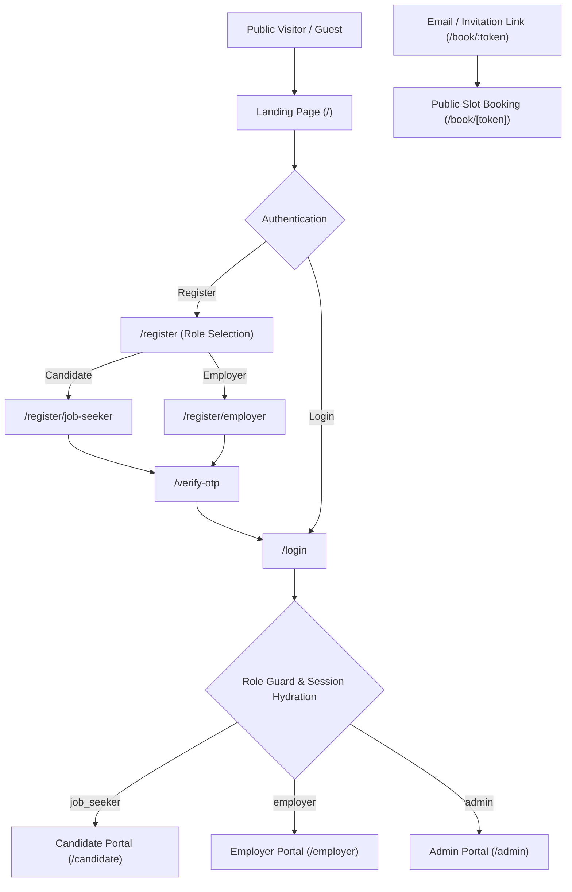
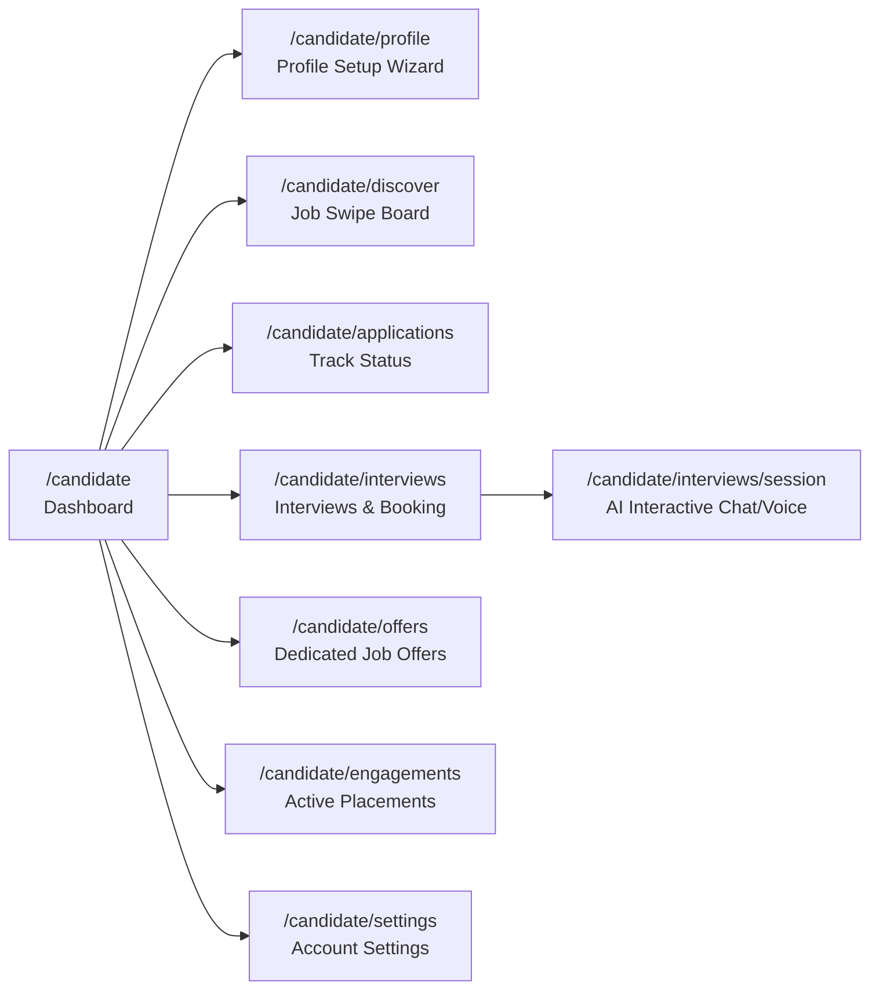
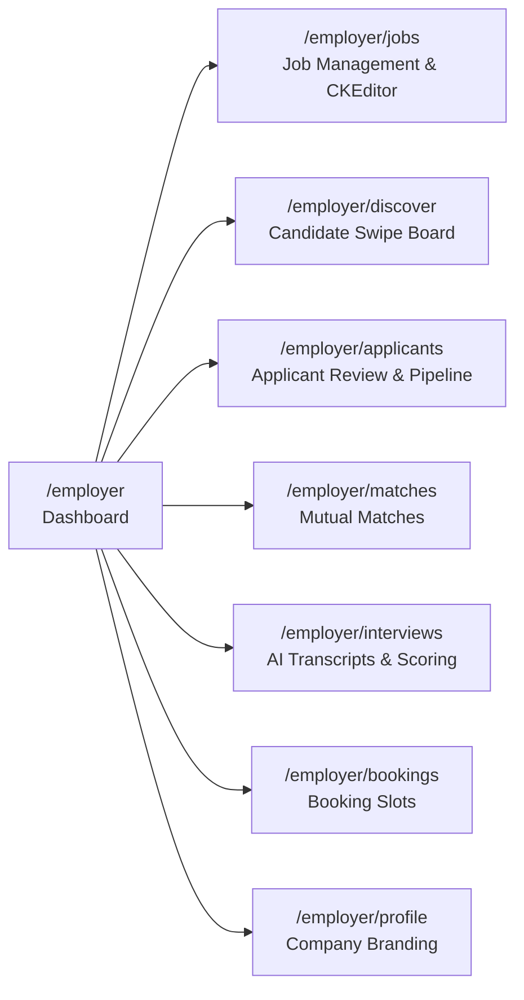
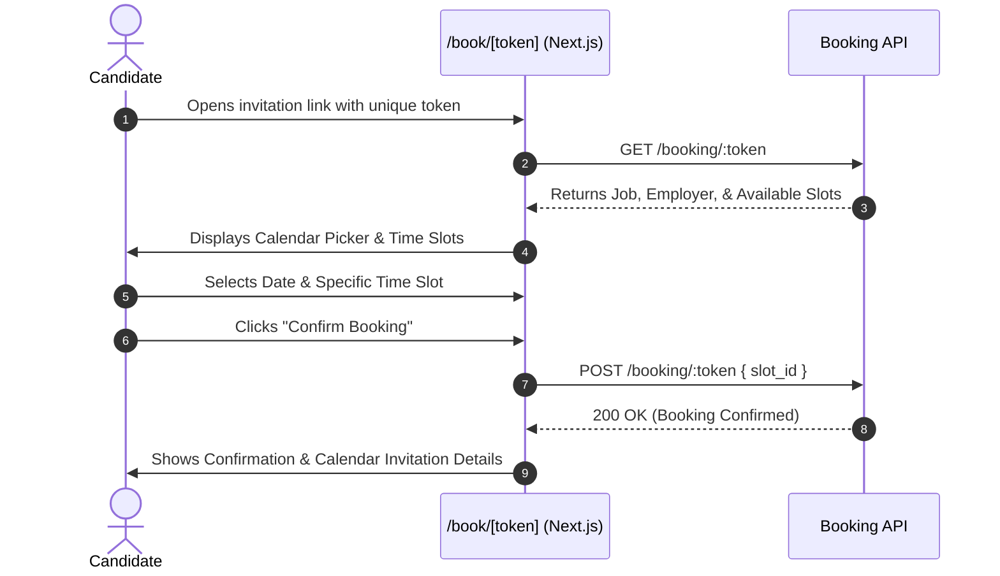
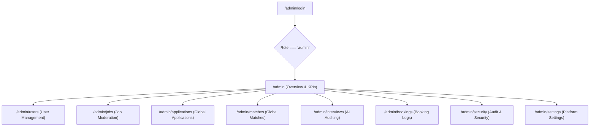

# WorkSwipe (ROLr) - Current User Flows Specification

This document provides a comprehensive, end-to-end breakdown of the user flows, role lifecycles, and page routing across the **WorkSwipe (ROLr)** application.

---

## 1. System Overview & User Roles

WorkSwipe is an AI-powered, swipe-based job matching and automated interviewing platform. The system operates on role-based authentication with four primary user roles/actors:

1. **Job Seeker (Candidate)**: Browses and swipes on job opportunities, builds a verified profile (with voice pitch), tracks application pipelines, and participates in AI-driven interactive interview sessions.
2. **Employer (Recruiter / Company)**: Creates and manages job listings (with auto-populating templates), discovers candidates via swipe or applicant queues, reviews AI interview results, and schedules video meetings.
3. **External Invitee / Candidate (Token Booking)**: Accesses public booking links to pick and confirm interview slots directly without prior portal login.
4. **Administrator (Admin)**: Monitors platform KPIs, moderates job listings, manages user verifications and account statuses, oversees application pipelines, and audits AI interview sessions.

---

## 2. Authentication & Onboarding Flow

### 2.1 Public Landing Page (`/`)
- **Route**: `app/page.tsx`
- **User Actions**:
  - Views product features, swipe demo previews, testimonials, FAQs, and platform statistics.
  - Clicks **"Get Started"** or **"Sign Up"** -> Redirects to `/register`.
  - Clicks **"Sign In"** -> Redirects to `/login`.

### 2.2 Registration & Role Selection (`/register`)
- **Route**: `app/register/page.tsx`
- **Step 1 - Role Decision**:
  - **Job Seeker Card**: "I'm looking for a job" -> Navigates to `/register/job-seeker`.
  - **Employer Card**: "I'm hiring talent" -> Navigates to `/register/employer`.
- **Step 2A - Job Seeker Registration (`/register/job-seeker`)**:
  - Input fields: Full Name, Email, Password, Confirm Password, Terms Agreement.
  - Submits -> Calls API `registerJobSeeker` -> Redirects to `/verify-otp?email={email}`.
- **Step 2B - Employer Registration (`/register/employer`)**:
  - Input fields: Company Name, Contact Name, Work Email, Password, Company Size, Industry.
  - Submits -> Calls API `registerEmployer` -> Redirects to `/verify-otp?email={email}`.

### 2.3 Email OTP Verification (`/verify-otp`)
- **Route**: `app/verify-otp/page.tsx`
- **Flow**:
  - Displays target email address from query string.
  - 6-digit numeric input with auto-focus shifting.
  - Action to **Resend Code** with countdown timer.
  - Submits valid OTP -> API stores JWT session tokens in cookies & Zustand store -> Automatically routes user to their appropriate role portal (`/candidate` or `/employer`).

### 2.4 Login (`/login`)
- **Route**: `app/login/page.tsx`
- **Flow**:
  - Email & password credentials form.
  - "Remember Me" toggle.
  - "Forgot Password?" link -> Navigates to `/forgot-password`.
  - Upon successful authentication:
    - Stores JWT token in secure cookies.
    - Hydrates `useAuthStore`.
    - Evaluates `user.role`:
      - `job_seeker` -> `/candidate`
      - `employer` -> `/employer`
      - `admin` -> `/admin`

### 2.5 Password Recovery Flow (`/forgot-password` & `/reset-password`)
- **Forgot Password**:
  - User submits account email -> API sends reset code/token -> User navigates to `/reset-password`.
- **Reset Password**:
  - User inputs OTP code, new password, and password confirmation.
  - Upon success -> Toast notification -> Redirects to `/login`.

---

## 3. Candidate (Job Seeker) Flow

### 3.1 Candidate Dashboard (`/candidate`)
- **Route**: `app/candidate/page.tsx`
- **Components**: Top greeting, theme toggle (Dark/Light), notification bell, stats grid (Total Swipes, Matches, Applications, Upcoming Interviews).
- **Profile Completion Checklist**:
  - Real-time progress bar (0% - 100%).
  - Actionable checklist cards (Basic Info, Voice Pitch, Education, Professional Experience, Job Preferences, Portfolio Links).
  - Clicking any incomplete section deep-links to `/candidate/profile?edit={section_id}`.

### 3.2 Profile Setup & Editing (`/candidate/profile`)
- **Route**: `app/candidate/profile/page.tsx`
- **Sections**:
  1. **Basic Info**: Name, Headline, Bio, Location, Phone, Profile Avatar upload.
  2. **Voice Introduction (Voice Pitch)**: In-browser voice recorder capturing audio waveform, preview audio playback, and instant upload for AI audio presentation to employers.
  3. **Education**: Degree, Institution, Field of Study, Graduation Year.
  4. **Professional Experience**: Job titles, company history, responsibilities, years of experience.
  5. **Job Preferences**: Desired roles, job type (Full-time, Remote, Contract), minimum expected salary.
  6. **Portfolio & Links**: GitHub, LinkedIn, Personal Website, Portfolio URLs.

### 3.3 Job Discovery & Swiping (`/candidate/discover`)
- **Route**: `app/candidate/discover/page.tsx`
- **Core Components**: `JobSwipeBoard.tsx`, `JobDetailsModal.tsx`.
- **Filter Pills**: `For You`, `Top Jobs`, `Newest`.
- **Swipe Board Mechanics**:
  - **Card Stack**: Multi-layer 3D card deck showing next job underneath.
  - **Swipe Right / Like Button**: Submits positive swipe (`action: "right"`) -> Automatically creates a job application (`submitted` status) or match -> Plays fly-off animation.
  - **Swipe Left / Reject Button**: Submits pass swipe (`action: "left"`) -> Discards job.
  - **View Details**: Opens full glassmorphic drawer modal showing job requirements, company profile, salary range, and benefits without leaving swipe flow.

### 3.4 Applications Tracking (`/candidate/applications`)
- **Route**: `app/candidate/applications/page.tsx`
- **Filter Pills**: `All`, `Today`, `Weekly`, `Monthly`.
- **Application Card**:
  - Displays job title, company name, application date, and current status tag: `submitted`, `reviewed`, `shortlisted`, `interview_scheduled`, `hired`, `rejected`.
  - **"Track Status" Action**: Opens `ApplicationTimeline.tsx` modal detailing step-by-step progress with blue dashed connectors and status checkpoints.

### 3.5 AI Interview Workspace (`/candidate/interviews` & `/candidate/interviews/session`)
- **Interviews List (`/candidate/interviews`)**:
  - Displays upcoming AI interview sessions and scheduled video interviews.
  - Shows session expiration countdown timer, job title, required skills, and "Join Interview" button.
- **Interactive Interview Session (`/candidate/interviews/session?session={sessionId}`)**:
  - **Onboarding Overlay**: Greets candidate by name with AI Assistant avatar.
  - **Conversational Question Flow**:
    - AI Bot displays questions one at a time (Behavioral, Situational, Technical).
    - Question hints and context.
  - **Dual Answer Submission**:
    - **Voice Answer**: Candidate presses microphone -> Records live response -> Real-time animated waveform -> Stop -> Listen to playback preview -> Submit audio response.
    - **Text Answer**: Direct response textarea with instant submission.
  - **Completion State**:
    - Final question submission triggers AI evaluation.
    - Displays "Interview Completed Successfully 🎉" completion card.
    - Direct shortcut button to continue swiping: "Discover Jobs".

### 3.6 Dedicated Job Offers Portal (`/candidate/offers`)
- **Route**: `app/candidate/offers/page.tsx`
- **Filter Tabs**: `All Offers`, `Action Required` (Approved offers awaiting candidate acceptance), `Accepted` (Contracts generated & dispatched), `Declined`.
- **Bilateral Rate Protection**:
  - Displays only candidate payout rate (`jobSeekerPayoutRate`); employer billing rate is strictly hidden.
  - Displays Rolr Inc. as contracting entity under the bilateral model.
- **Candidate Actions**:
  - **Accept Offer**: Calls `POST /candidate/offers/:id/accept` -> Generates parallel Documenso bilateral contracts -> Provides instant signing URL link.
  - **Decline Offer**: Opens decline modal with optional feedback reason -> Calls `POST /candidate/offers/:id/decline`.

### 3.7 Active Engagements (`/candidate/engagements`)
- **Route**: `app/candidate/engagements/page.tsx`
- **Active Placements List**:
  - Displays ongoing contracts with protected payout rates, billing cycle, duration, and status badge (`active`, `paused`, `completed`, `terminated`).
  - View full engagement details and milestones.

---

## 4. Employer Flow

### 4.1 Employer Dashboard (`/employer`)
- **Route**: `app/employer/page.tsx`
- **Features**:
  - High-level KPIs: Active Job Openings, Total Applicants, Matched Candidates, Scheduled Interviews.
  - Recent Applications table with quick status badges.
  - Quick action button: **"Post a Job"** (launches `CreateJobModal.tsx`).

### 4.2 Job Management & Creation (`/employer/jobs`)
- **Route**: `app/employer/jobs/page.tsx`
- **Create Job Modal (`CreateJobModal.tsx`)**:
  - **Restricted Job Roles**: Curated dropdown & 1-click quick-select role buttons (`Account Manager`, `Admin Support`, `Junior Website Manager`).
  - **Auto-Populate Templates**: Selecting any role instantly pre-populates:
    - Standard role responsibilities, qualifications, and competencies into the rich CKEditor summary.
    - Pre-selected required skill tags.
  - **Configurable Parameters**: Job Type (Full-time, Remote, Hybrid), Experience Level, Salary Range (Min/Max), Expiry Date.
  - **Reset Option**: "Reset to role template" button to revert edits to original template.
- **Job Actions**: View applicants for specific job, edit listing details, pause listing, or delete job.

### 4.3 Candidate Discovery (`/employer/discover` & `/employer/candidates/[id]`)
- **Route**: `app/employer/discover/page.tsx`
- **Mechanics**:
  - Displays candidate profile cards.
  - Shows candidate's full name, role headline, bio, experience years, skills tags, and voice pitch preview.
  - **Swipe Right / Shortlist**: Likes candidate for open job positions.
  - **Swipe Left / Pass**: Skips to next candidate.
  - **Candidate Full View (`/employer/candidates/[id]`)**: Comprehensive CV/resume breakdown, past employment history, education, and links.

### 4.4 Applicant Management Pipeline (`/employer/applicants`)
- **Route**: `app/employer/applicants/page.tsx`
- **Pipeline Workflow**:
  1. Filter applicants by Job Posting and Status (`submitted`, `reviewed`, `shortlisted`, `rejected`).
  2. Inspect applicant details via `ApplicantProfileModal.tsx`.
  3. Action buttons:
     - **Shortlist Candidate**: Advances candidate in the pipeline.
     - **Send AI Interview Invitation**: Generates AI interview session for candidate.
     - **Reject Application**: Updates status and closes pipeline.

### 4.5 Matches (`/employer/matches`)
- **Route**: `app/employer/matches/page.tsx`
- **Flow**:
  - Lists mutual matches (where candidate applied/swiped right and employer shortlisted/swiped right).
  - Displays match compatibility score, matched job title, and direct actions to schedule interviews.

### 4.6 AI Interview Reviews & Video Scheduling (`/employer/interviews`)
- **Route**: `app/employer/interviews/page.tsx`
- **Components**: `InterviewResultsModal.tsx`, `ShortlistModal.tsx`.
- **Reviewing Candidate AI Sessions**:
  - Review overall AI score (0 - 100%) and verification badge.
  - Question-by-question breakdown: candidate answer text, audio recording playback, and AI feedback score.
- **Advancement Decisions**:
  - **"Shortlist for Google Meet"**: Opens scheduling modal to input meeting link, dates, and times.
  - **"Select for Hire"**: Advances candidate to hired status.

---

## 5. Public Interview Booking Flow (`/book/[token]`)

This flow handles external interview self-scheduling for candidates without requiring prior authentication:

- **Route**: `app/book/[token]/page.tsx`
- **Error States**:
  - 403: "This booking link has expired or is no longer valid."
  - 404: "Invalid booking link. We couldn't find your interview session."
- **Success State**:
  - Displays green checkmark confirmation card with booked date, time, interviewer name, and meeting instructions.

---

## 6. Administrator Flow (`/admin`)

### 6.1 Admin Login & Authorization
- **Route**: `app/admin/login/page.tsx`
- Dedicated admin login endpoint; non-admin users attempting access are redirected.

### 6.2 Admin Control Center Pages
- **Overview Dashboard (`/admin`)**: System-wide analytics across custom periods (7d, 30d, 90d, 12m), time-series growth charts for users, jobs, applications, matches, and completed interviews.
- **User Management (`/admin/users`)**: Search, filter, inspect, and toggle status (Active, Suspended, Verified) for Job Seekers and Employers.
- **Job Moderation (`/admin/jobs`)**: Review active, flagged, or expired job postings across all employers; force edit or delete non-compliant postings.
- **Applications Oversight (`/admin/applications`)**: Global view of all applications, filterable by status.
- **AI Interview Supervision (`/admin/interviews`)**: Review all AI interview sessions, question logs, audio transcripts, and automated scoring reliability.
- **System Settings & Security (`/admin/settings`, `/admin/security`)**: Access logs, platform configs, and administrative notifications.

---

## 7. Route & Permissions Matrix

| Route Path | Allowed Roles | Description |
| :--- | :--- | :--- |
| `/` | Public (All) | Main landing page with marketing copy and features |
| `/login` | Public (Guest) | User authentication form |
| `/register/*` | Public (Guest) | Registration and role selection (Candidate / Employer) |
| `/verify-otp` | Public (Guest) | 6-digit email OTP verification |
| `/forgot-password`, `/reset-password` | Public (Guest) | Password recovery workflow |
| `/book/[token]` | Public (Token-authorized) | External interview slot selection & confirmation |
| `/candidate/*` | `job_seeker` | Candidate dashboard, swipe board, applications, offers, engagements (`/candidate/engagements`), profile, and AI interview session |
| `/employer/*` | `employer` | Employer dashboard, job creation, candidate discovery, pipeline, hire offers, engagements (`/employer/engagements`), and interview scoring |
| `/admin/*` | `admin` | Global administrative dashboard, moderation, user management, offer audit (`/admin/offers`), engagement management (`/admin/engagements`), and audit logs |

---

## 8. Bilateral Contracting & Rate Isolation Protocol

WorkSwipe (ROLr) enforces a strict **Bilateral Contracting Architecture**:
- **Rolr is the contracting party on both sides**:
  1. **Client Services Agreement** executed between Rolr and the Employer.
  2. **Contractor Agreement** executed between Rolr and the Job Seeker.
- **Rate Isolation Enforcement**:
  - **Job Seekers**: Never see `employerBillingRate` on offers or engagements (enforced by API stripping and UI guards). They only see `jobSeekerPayoutRate`.
  - **Employers**: Never see `jobSeekerPayoutRate` on offers or engagements (enforced by API stripping and UI guards). They only see `employerBillingRate`.
  - **Admins**: See both rates side by side with automated gross margin ($ and %) calculation.
- **Contract Dispatch Lifecycle**:
  1. Employer submits Hire Offer (`HireModal.tsx`) -> Status: `pending_admin_approval`.
  2. Admin audits rates and margin -> Approves offer (`OfferDetailDrawer.tsx`) -> Status: `approved`.
  3. Candidate reviews offer (`OfferCard.tsx`) -> Clicks "Accept Offer" -> Generates & dispatches bilateral Documenso e-sign contracts in parallel -> Status: `accepted`.
  4. Both parties e-sign agreements -> Active Placement established in Engagements (`/employer/engagements`, `/candidate/engagements`, `/admin/engagements`).

---

## 9. Summary of Core User Interactions

1. **Candidate Lifecycle**: Register -> Verify Email -> Complete Profile & Voice Pitch -> Swipe Right on Jobs -> Track Application Timeline -> Complete AI Interview -> Book Video Slot -> Review & Accept Bilateral Offer -> Sign Contractor Agreement -> Active Engagement.
2. **Employer Lifecycle**: Register -> Verify Email -> Set Up Company Profile -> Post Job with Auto-Filled Template -> Swipe on Candidates / Review Applicants -> Send AI Interview -> Review AI Score & Audio Answers -> Create Hire Offer via `HireModal` -> Sign Client Services Agreement -> Manage Active Engagement in `/employer/engagements`.
3. **Public Booking Lifecycle**: Receive Invitation Link -> Open `/book/[token]` -> Select Calendar Slot -> Confirm Booking.
4. **Admin Lifecycle**: Login to `/admin/login` -> Audit Platform KPIs -> Verify Users -> Moderate Jobs -> Audit Hire Offers & Bilateral Margins (`/admin/offers`) -> Approve/Reject Offers -> Oversee Active Engagements & Terminations (`/admin/engagements`).

